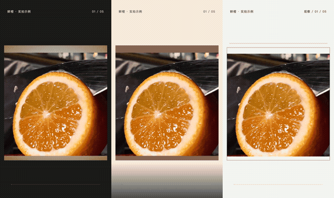
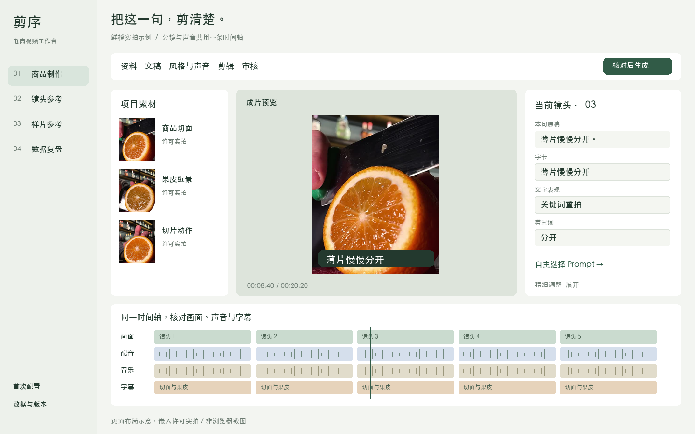

<div align="center">

# 剪序 · ecom-video-workflow

**把商品资料和实拍，做成能修改、能审核的短视频。**

写稿 · 选段 · 配音字幕 · 逐镜编辑 · 版本恢复 · 投后复盘

[下载 Mac 版](https://github.com/ceyyy427/ecom-video-workflow/releases/latest) · [操作指南](docs/MAC_WORKBENCH_GUIDE.md) · [安装配置](docs/CUSTOMER_INSTALL.md) · [问题反馈](https://github.com/ceyyy427/ecom-video-workflow/issues)

[看实拍效果](#实拍效果) · [看工作台](#工作台展示) · [开始制作](#从一个商品开始) · [开发与文档](#开发与文档)

</div>

## 实拍效果

同一段鲜橙实拍，在现有工作流中制作的三种呈现。下面直接截取已渲染样片，分别展示开场、收尾和动作讲解。


<details>
<summary><strong>播放三种样片的动态片段</strong> · 无声预览</summary>



左右顺序为克制质感、生活种草、细节讲解。这里是片段预览，完整工程样片为20.2秒；展示的是编排能力，不是客户签收或投放成绩。

</details>

实拍： [Maksim Semashko / Pexels](https://www.pexels.com/video/cutting-orange-with-knife-13107467/)，按 [Pexels License](https://www.pexels.com/license/) 使用。来源与派生记录见[展示素材说明](docs/README_SHOWCASE.md)。

## 工作台展示

素材、文稿、声音与修改都围绕同一个商品项目。以下页面按现有工作台布局绘制，嵌入许可实拍与真实成片帧；**页面图是布局示意，不是浏览器截图**。

### 剪辑：看原片，改这一镜

左边选素材，中间看画面，右边调整当前镜头。下方对照画面、配音、音乐和字幕轨；先查看修改影响，再保存新版。



### Prompt：自己选方法，再适配商品

按商品、人群、气质和这一句文稿查看适配说明。参考库支持自主检索；只有已经接入的本机变体可以带回镜头草稿，选择不会自动生成或确认。


### 审核：改过的版本，再看听一次

核对商品、动作、字幕与声音，保留逐镜意见。可以比较和恢复历史版本；生成成功不会替你勾选审核通过。


## 从一个商品开始

| 步骤 | 你来决定 | 工作流负责 |
|---|---|---|
| **01 上传** | 提供资料、同款素材，填写目标人群与希望气质 | 整理来源、识别素材、提示缺口 |
| **02 定稿** | 核对事实，选稿或提供自己的脚本 | 生成备选讲法，推荐三个创意方向 |
| **03 制作** | 选方向、实际试听并确认，核对最终分镜 | 匹配实拍选段、配音字幕、字卡和转场，渲染成片 |
| **04 修改交付** | 指出要改的一镜，逐镜和完整看听 | 预告影响、保留旧版，导出当前成果包 |
| **05 投后迭代** | 客户自行投放，导入报表并选择下一版假设 | 冻结账户×素材×日数据，关联成片并作描述性比较 |

事实、文稿、风格、听核和成片审核均由人确认。主渲染使用 Remotion / FFmpeg，本机模型优先；平台投放由客户操作。

## 已有能力

- **商品资料或自有脚本**：保留事实来源、备选文稿与素材缺口。
- **同款实拍剪辑**：SKU/配色约束、主体可见度、动作和重复检查，支持同句多段实拍。
- **声音与文字**：上传配音或使用已配置火山语音，本机对齐、停顿字幕、试听与单句重做；可选关键词重拍、分词揭示、大小字对照。
- **逐镜与版本**：修改影响预告、旧新版本比较与恢复、逐镜审核、已审/待审导出。
- **复盘闭环**：冻结报表、保留缺失值与口径，关联创意特征、下一版假设和后续数据；不作因果归因。

范围与限制见[能力矩阵](docs/CAPABILITY_MATRIX.md)，本版实现与测试见[0.17.0验收](docs/TYPOGRAPHY_PROMPT_ACCEPTANCE.md)。

## Mac 快速开始

面向 **Apple Silicon Mac**。从[版本发布](https://github.com/ceyyy427/ecom-video-workflow/releases/latest)下载首次安装包，完整解压，双击 `启动剪序.command`，再按“首次配置”页面检查环境、模型和配音。

| 文件 | 用途 |
|---|---|
| `jianxu-mac-apple-silicon-0.17.0.zip` | 首次安装，含客户操作指南 |
| `jianxu-update-0.17.0.zip` | 旧版先备份，再从维护页面上传升级 |
| `SHA256SUMS.txt` | 核对下载文件 |

这是联网安装依赖的源码客户版。需 Python 3.11+、uv、Node.js 22/24、FFmpeg/ffprobe 和中文字幕字体；模型另行下载，软件包不附客户项目或密钥。Windows 入口保留，原生验收另行进行。

<details>
<summary>从源码安装与启动</summary>

```sh
git clone https://github.com/ceyyy427/ecom-video-workflow.git
cd ecom-video-workflow
python3 scripts/install_customer.py
python3 scripts/launch_customer.py
```

启动后使用窗口显示的本机地址。首次安装、模型和常见错误见[安装指南](docs/CUSTOMER_INSTALL.md)。

</details>

## 页面入口

| 要做什么 | 页面 |
|---|---|
| 商品资料、文稿、声音与剪辑 | `/create` |
| 国内定位、六个动态方向与发布文案草稿 | `/ideas`（[D1指南](docs/DOMESTIC_D1_USAGE.md)） |
| 自主选 Prompt 与逐句适配 | `/prompts` |
| 本机样片与效果参考 | `/samples` |
| 客户投放后的报表与冻结复盘 | `/distribution` |
| 创意假设与下一版比较 | `/experiments` |
| 环境、模型与语音配置 | `/setup` |
| 备份恢复、独立版本升级 | `/maintenance` |
| 操作步骤和常见问题 | `/guide` |

## 开发与文档

[客户指南](docs/MAC_WORKBENCH_GUIDE.md) · [文字与 Prompt](docs/TYPOGRAPHY_PROMPT_GUIDE.md) · [备份恢复](docs/CUSTOMER_RECOVERY.md) · [交付清单](docs/CUSTOMER_HANDOFF.md) · [架构](docs/ARCHITECTURE.md) · [状态机](docs/STATE_MACHINE.md)

<details>
<summary>开发验证命令</summary>

```sh
uv sync --locked
npm ci --prefix render/remotion
node render/remotion/setup-browser.mjs
uv run pytest -q -k 'not actual_browser_layout'
node --test tests/web/*.test.cjs
npm run check --prefix render/remotion
```

自动测试的模拟确认用于工程验收，不能替代客户实际听审。

</details>

## 参考与致谢

README 借鉴 [NarratoAI](https://github.com/linyqh/NarratoAI) 和 [MoneyPrinterTurbo](https://github.com/harry0703/MoneyPrinterTurbo) 的“先展示界面与效果，再介绍能力和启动方式”的组织方式，没有复用它们的截图、品牌或广告内容。

项目采用与参考的工具还包括 [taste-skill](https://github.com/Leonxlnx/taste-skill)、Remotion 及已记录的上游实现，具体见[开源采用依据](docs/third-party/typography-prompt-reuse.md)。代码、模型和媒体分别适用相应许可；本页不公开客户原片、私人参考视频和配音。
