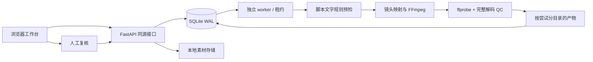
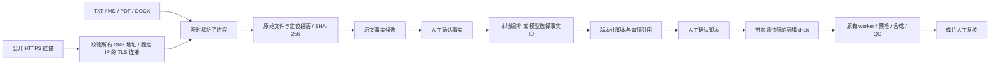

# 镜头配方增量

`shotcraft.py` 的有限枚举/逐句编排 → 客户三风格说明 → `customer_planner.py` 新分镜 opt-in → `RecipeShot.tsx` 帧函数渲染。字幕按相同分派条件选色，词时间不变；镜头缓存包含新props。旧分镜无配方字段时保留原分派；无数据库迁移、模型传输或平台写入。参考/Prompt仅作数据，详细契约见 SHOTCRAFT_USAGE.md。

# 当前架构与 P0–P1 历史设计

P16：`experiment_contracts → experiments → experiment_api → /experiments` 管理不经模型生成的本地假设、人工选择、草稿和冻结数据对比。Customers.revise / Products.save_draft 增加可选 receipt 接缝，使领域结果、实验关联和幂等回执同事务；原调用不变。Store.submit 对关联新版执行始终有效的风格守卫；复用原事实/稿件/听核/审片检查。改稿先保存待确认稿件，再由用户完成确认和准备后关联同商品新版。评估只读两份冻结快照，Decimal 算术，不调用模型、平台或渲染器。渲染仍由用户在原制作流程提交。详见 P16_USAGE.md。

P15：`review_contracts → review_snapshots / creative_features → review_api → distribution.html + reviews.js`，将现有报表算法与成片绑定冻结为独立证据。一次 BEGIN IMMEDIATE 内选择每日最新完整批次、绑定、提交快照和标签，保存规范 JSON、SHA256 与来源索引；后续读取不重新聚合。原报表限量验证，视频只引用已有绑定与登记哈希，未在冻结时重新哈希。默认关闭；详见 P15_USAGE.md。不触发制作、模型调用、平台写入或 P16 实验。

P14 增加固定本机执行图：不可变提案 → 独立 Runtime 执行/预算/人工等待 → 现有识别与渲染 worker。领域写入与幂等 effect 回执同事务，原任务租约之外再用同目录计算租约协调识别、ASR、选段和渲染；正式提交校验两类租约。人工风格单独留证，听核通过原接口保存后再恢复。模型仅用既有 loopback Ollama 与本机 ASR，无新增云传输。详见 P14_USAGE.md。

截至 P13：现有客户项目、产品事实/文稿、素材识别、版本化分镜与三条渲染路径、审核、平台接口和投放后报表均保留。下文 P0–P1 章节描述当时实现；后续能力以 README 对应阶段指南为准，不将历史限制当作当前能力清单。

P13 新增 `agent_contracts.py` 严格数据契约 → `agent_service.py` 本机读取提案服务 → `agent_api.py/agent_cli.py` 两种入口。`providers/contracts.py` 只定义 Provider 数据结构，不注册传输。四个白名单工具复用 Customers/Reporting 的读取方法，事务内核对版本并保存运行/事件，既不调用模型也不派发 worker。目录和结果可查询；没有 execute/resume/cancel。API 继承现有 Host/Origin/token 边界，CLI 使用本机维护者文件权限。

schema v9 新增两张 Agent 表，旧领域状态机独立不变。Agent `proposed/failed` 与领域 `ready/needs_review` 没有互相转换关系。开关默认关闭但不阻止数据库正常升级；回退见 [P13 指南](P13_USAGE.md)。未来编排、冻结复盘和迭代分别留在 P14–P16。

本地单用户的可复核视频制作闭环。所有代码、素材和队列由本机维护者负责；当前实现独立于第三方 MCP 工具，先通过确定性 FFmpeg 跑通 P0，再考虑替换后端适配器。

## 模块边界

`api.py` 负责 HTTP 输入、文件传输和本机访问边界；不渲染。`db.py` 是状态迁移唯一入口。`worker.py` 协调固定步骤而不执行自然语言命令。`media.py` 校验本地文件、路径和 subprocess 生命周期。`renderer.py` 实现纯确定性分镜与编码。`audit.py` 执行固定规则并列出人工检查缺口。

选择静态 HTML/CSS/JavaScript 而不是 React/Vite：P0 只有一个工作台，避免引入 Node 构建与前后端跨域配置；后续 API 不要求更换前端才能复用。UI 使用 DOM textContent，素材名与脚本不作为 HTML 执行。所有代码、CSS、字体都在本地，页面不加载第三方资源。

## 文件生命周期

上传 → 随机 ID 命名 → 解码信息检查 → 计算 SHA-256 → 在草稿事务中登记。发生错误删除尚未登记的上传文件。提交后保存完整输入快照；worker 在合成前再次验证哈希和类型。每次领取写入 `jobs/{id}/attempt-{attempt}-{token}/`，失败产物不登记到 artifacts。

成功完成 QC 后，使用仍有效的租约在一个事务里登记五类文件并转为 needs_review。API 只按数据库登记的 kind 提供下载，不接受客户端路径。原始文件和中间产物不通过 static 公开。

## API 摘要

| 方法 | 路径 | 行为 |
|---|---|---|
| GET | `/api/session` | 获取本次 API 进程写入令牌 |
| GET | `/api/health` | 本机依赖与最近 worker 心跳 |
| GET/POST | `/api/jobs` | 最近 100 个任务 / 创建草稿 |
| GET/PUT | `/api/jobs/{id}` | 任务详情 / 仅修改草稿 |
| POST | `/api/jobs/{id}/assets` | multipart: kind + file |
| GET/DELETE | `/api/jobs/{id}/assets/{asset_id}` | 读取素材 / 草稿中移除 |
| POST | `/api/jobs/{id}/submit` | 原子锁定与幂等提交 |
| POST | `/api/jobs/{id}/cancel` | 撤销执行租约 |
| POST | `/api/jobs/{id}/retry` | 重排有剩余次数的失败任务 |
| POST | `/api/jobs/{id}/clone` | 保留来源 ID 并复制为新草稿 |
| POST | `/api/jobs/{id}/review` | ready/rejected + reviewer/note/confirmed |
| GET | `/api/jobs/{id}/artifacts/{kind}` | 已登记产物；download=true 下载 |

写入必须携带 `X-Workflow-Token`；浏览器必须同源。404 表示找不到记录/文件，409 是状态冲突，413 超限，422 输入无效。OpenAPI JSON 位于 `/openapi.json`，关闭依赖 CDN 的 Swagger 页面。

## 演进边界

P1 的产品输入与可选模型 API 已落地，详见下节。身份系统、云存储与投放报表仍属后续范围。若迁移到 PostgreSQL，需要保留租约令牌、输入快照、文件哈希和复核记录的语义。不能把当前 loopback 安全边界直接用于互联网多租户部署。

## P1：来源驱动的产品脚本（已实现）

- `sources.py` 提取可定位文字，不判断真实性。TXT/MD 按行，PDF 按页，DOCX 按段落/表格行，网页按正文段落和 Product JSON-LD 路径。完整短段落直接成为候选；长段落需人工摘录连续原文。原文统一空白符，因此引文是“标准化提取文本”，不是原文件字节片段；原件保留用于核对。
- `network.py` 只允许无账号信息的公网 HTTPS/443。DNS 的所有结果均须公网；连接固定到已校验 IP，TLS 使用原域名验证证书。每次重定向重新验证，最多 3 次跳转；不转发 Cookie/登录态，不使用环境代理，不执行 JavaScript。响应 ≤ 2 MiB，拒绝压缩传输；HTML 快照仅附件下载。
- `source_process.py` 将解析/联网放到独立进程，最多同时 2 个，文档/网页 40 秒，模型 45 秒。POSIX CPU 上限 30 秒；Linux 地址空间上限 1 GiB。macOS/Windows 不声称具备内存隔离或 OS 沙箱。PDF ≤ 50 页，DOCX 解压大小与压缩比有限制。
- `products.py` 是资料生命周期唯一入口。每次提交携带 revision，短事务再次检查。慢解析与模型调用不持有数据库写锁；处理完成时版本已变则拒绝提交并清理未登记文件。
- `generation.py` 本地方式直接编排最多 8 条事实。模型方式发送固定系统指令与确认事实 ID/文字，输出严格限制为 ID 序列与固定开场键；生成实际文案仍用事实原文。模型错误不落库、不静默降级。人工编辑的新版本标记 `human_rewrite`，只验证引用存在，语义准确性靠人工确认。
- 脚本确认和创建剪辑任务在同一事务中完成；`script_approvals.draft_id` 唯一，重复点击复用原任务。剪辑任务中的产品脚本和标题不可编辑，复制任务继续保留来源。每镜时长、画面素材和配音可以在 draft 阶段修改。
- worker 在合成前验证来源文件哈希。新增 `provenance.json` 产物，manifest 内嵌完整来源快照；audit 标明来源完整性与“仅人工语义核验”。规则阻断时仍可下载来源清单。

P1 仍使用本地单用户架构，未加入身份系统、云存储、投放与数据报表。模型 API 是可选用户配置；本地编排无外部依赖。未来多用户/云端需要单独设计鉴权、组织隔离、队列与存储策略。

### P1 API

| 方法 | 路径（前缀 `/api/products`） | 内容 |
|---|---|---|
| GET / POST | 空路径 | 最近 100 个资料夹 / `{title}` 新建 |
| GET | `/capabilities` | 支持格式、模型是否配置；不返回密钥 |
| GET | `/{id}` | 资料、事实、脚本、审批与事件 |
| POST | `/{id}/documents` | multipart `file, revision` |
| POST | `/{id}/links` | `{url, revision}` |
| GET | `/{id}/sources/{sid}` | 原件附件下载；不接受路径 |
| POST | `/{id}/quotes` | `{revision, source_id, unit_id, text}` 连续原文摘录 |
| POST | `/{id}/facts/confirm` | `{revision, fact_ids, reviewer, note, confirmed:true}` |
| POST | `/{id}/scripts/generate` | `{revision, mode:extractive或model, external_consent}` |
| POST | `/{id}/scripts` | `{revision, scenes:[{text,fact_ids}]}` 保存人工编辑新版本 |
| POST | `/{id}/scripts/confirm` | `{revision, draft_id, reviewer, note, confirmed:true, seconds}` 创建剪辑草稿 |

所有写操作复用同源令牌与请求体大小限制。API 模型禁止额外字段，无法由客户端注入来源哈希、路径、审批人之外的系统状态或模型密钥。

## P2 增量

独立 `/distribution` 页通过同源 REST 调用投放和报表服务。第三个进程 `platform_worker` 消费本地 ZIP 队列与只读日报队列。`Distribution` 负责人工确认和回执；`Reporting` 负责输入校验、来源批次、幂等覆盖及确定性指标；`OceanWatch` 固定版本 CLI 仅开放 `qc-reports materials`。不存在平台写命令路由。凭据留在用户独立 Ocean Watch 状态目录，不进入业务 DB。报表错误仅返回安全诊断，未知数据和真实零值保持区分。

## P3 增量

`/qianchuan` → `QianchuanAuth` / `QianchuanTasks` → 持久化原生队列 → `platform_worker` / `qianchuan_worker` → `QianchuanHTTP` 固定官方 HTTPS 接口。原生凭据与 Ocean Watch 独立；macOS 使用 Security.framework，Linux 使用 Secret Service，无明文回退。跨进程凭据锁序列化 OAuth 配置/授权/刷新，任务所有权锁覆盖外部写入至结束，并与恢复/人工核验共享。

上传与广告创建分别人工确认，原生 task 不复用 P2 人工交接状态。业务失败、未派发失败、结果不明分别保留；不会自动重复写入。原生授权存在时，P2 报表同步使用原生只读 API 并标注 qianchuan_api，授权失败不跨凭据回退。

默认真实写入关闭，需用户在自己本机配置应用并授权、显式启用 ECOM_QIANCHUAN_WRITES=1 后逐项确认。API/权限依据、字段和实际验收边界见 P3_CONTRACTS.md、P3_USAGE.md、P3_ACCEPTANCE.md。

## P4 编辑决策与渲染

`storyboard.py` 提供严格分镜模型、素材归属/范围验证和本机 TTS 能力检查；`storyboard_renderer.py` 在已锁快照上执行运镜、源选段、文字排版和声音混合。旧 renderer 在 snapshot.storyboard 存在时委派，旧任务继续原逻辑。声音与画面都受 worker 租约/取消检查控制，输出仍完整解码检查并进入人工复核。

`web/storyboard.js` 管理草稿编辑版本，`/samples` 汇集已生成的三种最新示例风格，`/guide` 是客户操作指南。复盘页将日报导入与来源/素材关联放在交付包之前。接口保留不等于已真实联调或启用投放。

## 视频呈现规则（polished-v1）

`visual_finish.prepare_visuals` 为正式渲染和风格预览提供同一份实测标题与字幕PNG。MotionPlan.visual_finish默认legacy，新建定向分镜显式polished-v1；不迁移旧任务。标题/强调仅影响呈现，字幕时间、原文、声音和素材入点不变；强调必须使用全真字锚点。manifest记录来源，场景key包含呈现规则及引擎hash，逐镜修改生成新版本。只读第三方Skill及模型不被运行时加载。质量样片由只读quality_router提供，不创建/批准客户任务。
