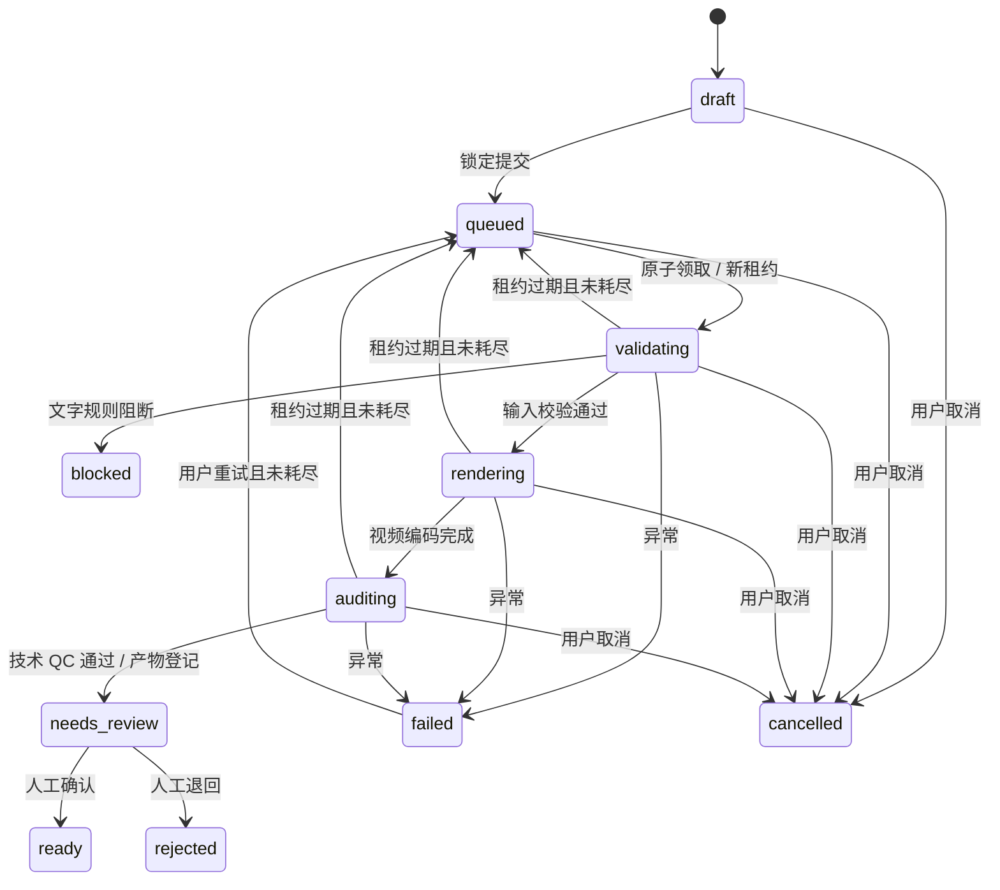
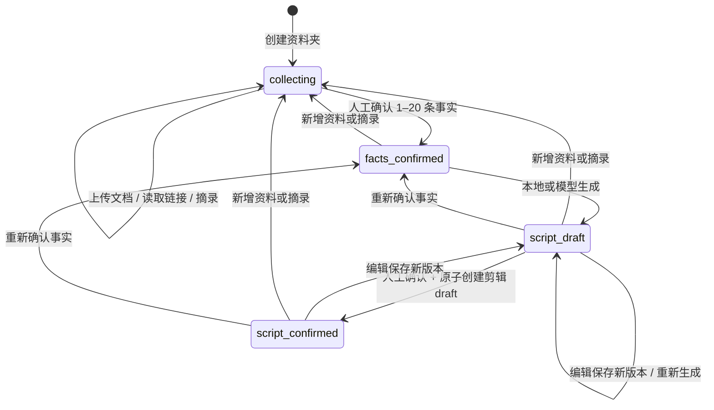
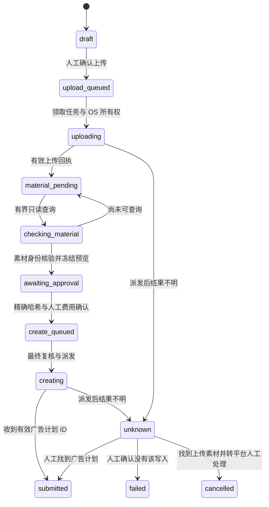

# 任务状态机

## P14 执行状态（不替代视频状态）

project.produce 保存不可变 proposed 提案和独立执行记录。execute 初始化一次墙钟时限：proposed → queued → running；running 可转 waiting_human、paused、failed、unknown 或 cancelled。resume 只接受 paused/waiting_human，重核输入并沿用预算；取消只撤销本次拥有的子任务。无回执且已预留推理的中断步骤为 unknown，不重发。

缺事实/稿件/素材/配音/风格或听核时等待人工；成片 needs_review 对应 waiting_human/film_review，人工置 ready 后执行才 completed。Agent 永不调用确认入口。新 execute/pause/resume/cancel 必须绑定 plan_hash、执行 revision 与策略；过期输入不会跳过人工确认。proposed 不可通过 pause/resume 绕过 execute 时限。

## P13 独立运行记录

有效新命令 → 同一短事务内 `request_accepted` → `proposed` + `proposal_ready`，或 `failed` + `tool_failed`。这两个状态都是本次读取的终态；没有 queued/running/execute/resume/cancel，也不会转换旧视频任务状态。`proposed` 不表示已生成或审核成片。

输入/开关/请求 ID 冲突产生未持久化的 `rejected`；同 request_id 同输入重放原记录，异输入拒绝。项目工具同时绑定客户项目与产品版本；改稿后应携带当前版本和新请求 ID。既有事实、文稿、风格、听核和成片确认入口不变。P14 独立执行状态见上节，不改写 P13 提案终态。

## 既有视频任务

| 状态 | 可操作 | 下一步 |
|---|---|---|
| draft | 编辑、上传、移除、提交、取消 | 至少一个画面素材后提交 |
| queued | 取消、复制 | 等待 worker |
| validating/rendering/auditing | 取消、复制 | 心跳续租；错误转 failed |
| needs_review | 下载、预览、通过/退回、复制 | 逐项人工核验 |
| ready | 下载、复制 | 本地人工复核完成，未投放 |
| rejected/blocked | 下载可用报告、复制 | 新草稿中修改 |
| failed | 重试（剩余次数）、复制 | 查看 error 定位问题 |
| cancelled | 复制 | 不原地恢复 |

45 秒租约；worker 每 5 秒心跳；空闲每 2 秒查看队列。租约过期在下次 claim 时恢复，attempts 每次实际领取加一。到 3 次则 failed 并拒绝原地 retry。普通运行错误不自动重试，由用户决定。复制任务重新计数，同时保留 parent_id 与原记录。

取消原子清除 token；旧进程即使暂未察觉，也不能登记产物。正常运行中最多约 5 秒检测取消并结束 FFmpeg。主进程关闭时 worker 使用停止事件终止媒体子进程，运行中的数据库记录留待重启后租约恢复。

needs_review 是唯一允许人工决定的状态；blocked 不能直接放行。用户不确认清单、不填姓名或说明均不能完成复核。ready 的含义仅为本地人工复核通过。

## P1 产品资料状态机（与剪辑状态独立）

- 每次写入校验 revision 并递增，慢任务回写再次验证，避免旧页面覆盖新版本。
- 事实未确认不能生成脚本；任何产品描述都必须引用本轮已确认事实。无引用文字只允许固定中性开场/结尾。
- 人工改写保存新版本，必须重新确认脚本。引用存在仅表示关联，不能证明改写忠于原意。
- 只有当前事实确认下的当前脚本能首次确认；重复确认已批准的同一版本返回原任务，不创建第二个任务。
- 新资料不改写旧审批和已创建剪辑任务。旧任务继续使用冻结资料与脚本，前提是原件完整。
- 产品剪辑 draft 可改时长和素材，但不可改标题与脚本；复制继续保留该限制。需要改变文案时回产品资料夹编辑→确认→新剪辑任务。
- 内容预检 `blocked` 无直接放行入口；即使事实和脚本已人工确认，仍不能跳过成片检查与最后复核。

## P2 投放与复盘

`awaiting_approval → queued → exporting → awaiting_manual → submitted → active/paused/rejected/completed`。submitted 及后续状态来自人工回执，非 API 自动核验。active 和 paused 可相互转换，rejected/completed 终止；queued 之前可取消。exporting 失联过期转 failed，不自动重投。确认绑定 snapshot_hash，重复确认返回 409。

报表 `queued → fetching → completed/failed`，只有完整批次成功入库才能 completed。所有天成功后一个事务提交；过期 worker 不能提交。与成片 ready 状态相互独立，不篡改原始生产任务状态。

## P3 原生千川

未派发阶段失败可停止；取消仅作用于待处理本地任务，不调用平台撤销。过期/改配/重新授权使旧审批失效；有素材且尚未派发创建的失败任务可重新查询并生成新预览。自动只读轮询最多 20 次，每次间隔 30 秒。确认最多有效 15 分钟。

失去租约但仍持 OS 所有权锁的旧进程，不会被提前恢复为可人工解除的 unknown；需进程结束释放锁后恢复。任何 uncertain 写入都不自动重发，同账户/成片的其他任务在最终派发时也被阻断。submitted 不代表平台审核通过或已投放。

## P4 分镜与复盘边界

分镜编辑只允许 draft。save_storyboard 不改变主状态；提交后沿用 queued → validating → rendering → auditing → needs_review → ready/rejected。本机语音放不进镜头时转 failed，错误包含所需最短时长，不截断后冒充成功。修改需要新草稿，保留原成片和复核。

客户平台投放不由本项目执行。CSV 导入、只读同步和素材关联无需本地投放任务；原生写入接口保留且默认关闭。样片不自动代签人工复核。

## P15 冻结复盘

人工发起 → 同一事务核对/计算/冻结 → 返回不可变 `review_id/snapshot_hash`；失败回滚，不留下半份复盘。同 `request_id` 同契约输入重放原结果，不重新读取报表；异输入返回 409。新批次或标签只能由新请求创建下一份快照，没有覆盖、删除、apply 或自动执行状态。

完整性 `empty/partial/complete` 与来源核对状态均属数据描述，不是制作/投放状态。素材日分别保留已上报、未上报、缺报表、覆盖但空；未知不补零。来源文件后来缺失不影响历史 JSON 重读，重新核对/下载会明确失败。此流程不改变 `jobs`、审批、Agent 执行或平台任务状态。

## P16 人工选择的创意迭代

`proposed → selected/rejected → draft_created → awaiting_data → evaluated`。选择与应用分开留证；selected 才可应用一次。改画面创建一个 draft；改稿先创建待确认 script_draft，确认/准备后另以 attach 关联该稿件唯一的同商品 draft。所有写操作核对 expected_revision 并持久化幂等命令回执；父片、事实、稿件、媒体或配音变化时旧变更集拒绝。

新版保持现有制作状态机与人工审片。新增风格守卫绑定分镜 hash/revision，改分镜后须重确认；继承时间戳不继承本轮听核。原片及旧审批不改写。awaiting_data 只表示等客户数据，不是平台已投放的回执。

评估追加保存；缺失、口径/窗口未知或不一致、窗口重叠或样本门槛不足，评估为 insufficient_evidence，实验留 awaiting_data。条件满足为 descriptive_available，实验 evaluated，仍无因果结论或胜出者。之后重导须新冻结/新评估，不覆盖历史；新评估不足可重新留 awaiting_data，旧的 evaluated 证据仍在。
